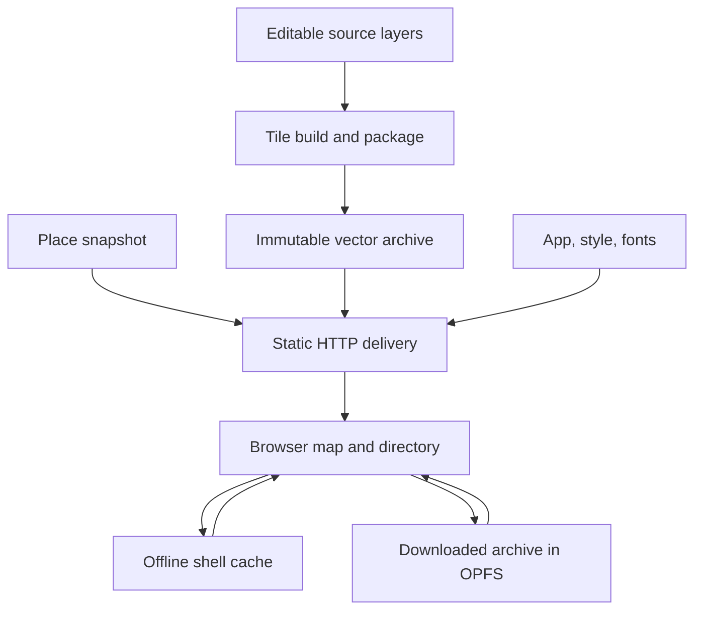
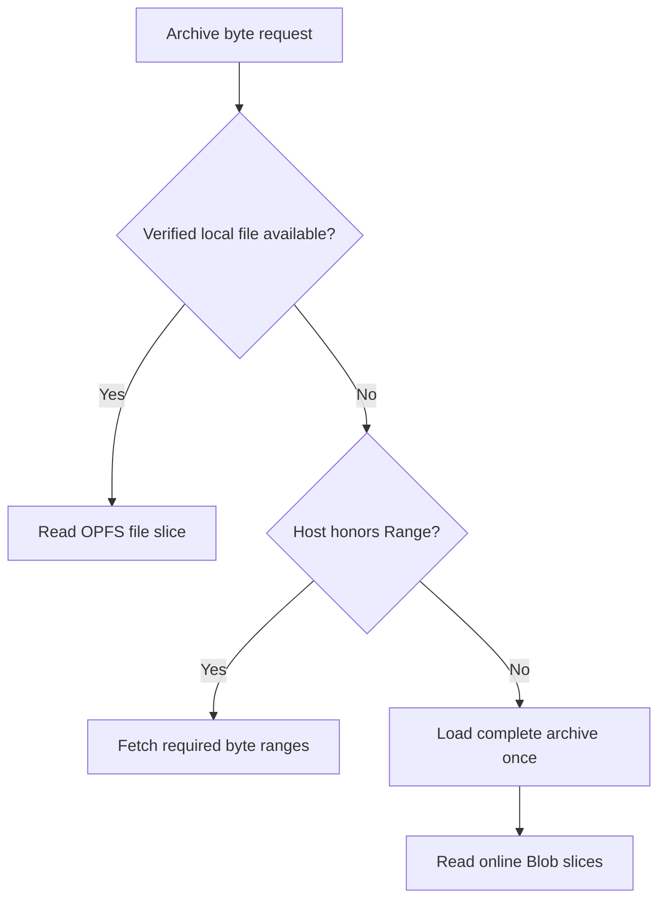
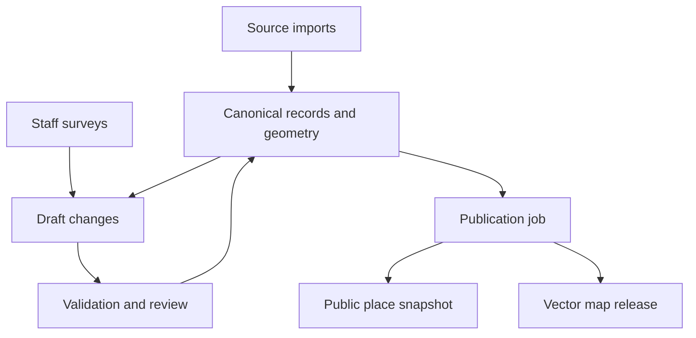

> Detailed design and historical verification notes. Start with [current architecture](../../ARCHITECTURE.md), [testing](../testing.md), and [release procedure](../runbooks/release.md) for maintained operational guidance. Future proposals below are not implemented features.

# Kompas: architecture, implementation, operations, and growth

**A read-only Montenegro map and directory, with a path toward a local 2GIS competitor.**

Date: 18 October 2026. This guide describes the working vector PoC and the GitHub-ready source export. It distinguishes implemented behavior, observed evidence, and proposed production work. It is not a claim that a complete nationwide directory, native application, or navigation system already exists.

## Current stack

This is the implemented and deployed stack as of 18 October 2026. The prepared Pages source is the `main` branch's repository root; see the release runbook for the owner setting change. Public URL: https://ivanov-gv.github.io/cg-map/.

| Layer | Current implementation | Responsibility |
| --- | --- | --- |
| Application UI | Plain JavaScript ES modules, HTML, CSS | Search, categories, results, place details, responsive layout, satellite toggle |
| Map renderer | MapLibre GL JS **5.12.0**, WebGL | Camera, vector/raster rendering, labels, clustered place markers |
| Vector basemap | MVT geometry in a **PMTiles v3** archive; PMTiles JS **4.3.0** | Prebuilt roads, buildings, water and land; HTTP range reads |
| Satellite sample | 16 local **256 × 256 WebP XYZ tiles at zoom 17**, plus a WebP preview | Roughly 900 × 900 m of central Podgorica; bounded raster layers beneath street labels and place markers |
| Place directory | GeoJSON snapshot, searched and filtered in the browser | 1,811 places; no search API |
| Offline application assets | Service worker and Cache Storage | App, places, fonts, icons and satellite sample |
| Offline vector archive | Origin Private File System (**OPFS**) | Verified archive download and local byte-range reads |
| Data sources | OpenStreetMap-derived GeoJSON, Natural Earth context; separate eMapa Ortofoto 2025 sample | Editable source geometry and a separately attributed imagery sample; imagery reuse rights remain unconfirmed |
| Vector build | Node.js: `geojson-vt` **4.0.2**, `vt-pbf` **3.1.3**; Python packaging tools | Clip/simplify/encode MVT tiles, package archive, generate hashes and offline manifests |
| OSM extraction | Python, `osmium`, Shapely | Optional upstream import; not needed to view the shipped map |
| Public hosting | **GitHub Pages**, HTTPS, HTTP byte ranges | Serve committed static assets from the repository root |
| CI and tests | **GitHub Actions**, Node.js test runner, Python `unittest`, Go build | Automated source/data checks; latest satellite release passed CI and Pages deployment |
| Optional local hosting | Python standard library or Go `net/http` | Serve `web/` locally; neither runs on GitHub Pages |

**There is no backend API, application database, React framework, or server-side search in the deployed PoC.** Go/PostGIS and internal editorial services elsewhere in this guide are future options, not deployed dependencies.

`web/` is the application source/public asset tree. Run `node tools/publish-pages.mjs` after changes to refresh the committed root deployment output. Run `node tools/finalize.mjs` first when app or dataset changes require new offline manifests. Downloaded satellite imagery is bundled locally; the deployed app does not call eMapa at runtime.

## Contents

- [Current stack](#current-stack)

1. [The problem](#1-the-problem)
2. [Scope and present status](#2-scope-and-present-status)
3. [The concepts we must keep separate](#3-the-concepts-we-must-keep-separate)
4. [Comparable projects and their engineering experience](#4-comparable-projects-and-their-engineering-experience)
5. [Options and trade-offs](#5-options-and-trade-offs)
6. [Current system design](#6-current-system-design)
7. [Why this implementation behaves better](#7-why-this-implementation-behaves-better)
8. [Runtime behavior step by step](#8-runtime-behavior-step-by-step)
9. [Map generation and source organization](#9-map-generation-and-source-organization)
10. [Offline storage and update semantics](#10-offline-storage-and-update-semantics)
11. [Implementation map](#11-implementation-map)
12. [Usage on different clients](#12-usage-on-different-clients)
13. [Editing map content internally](#13-editing-map-content-internally)
14. [Changing the visual design](#14-changing-the-visual-design)
15. [Deployment and releases](#15-deployment-and-releases)
16. [Testing and evidence](#16-testing-and-evidence)
17. [Scaling from 10 users to 10K and beyond](#17-scaling-from-10-users-to-10k-and-beyond)
18. [Keeping information relevant to the real world](#18-keeping-information-relevant-to-the-real-world)
19. [Future internal tools and backend](#19-future-internal-tools-and-backend)
20. [Growing into a competitive product](#20-growing-into-a-competitive-product)
21. [Future-proofing and redesign triggers](#21-future-proofing-and-redesign-triggers)
22. [Known caveats and production gaps](#22-known-caveats-and-production-gaps)
23. [Next steps](#23-next-steps)
24. [GitHub handoff](#24-github-handoff)
25. [References](#25-references)

## 1. The problem

The immediate goal is to let someone explore Montenegro, find a business or attraction, inspect its details, and continue using downloaded content without a connection. The initial engineering constraints are a small implementation budget, Go experience, limited frontend experience, free libraries, portable hosting, and no Terraform or mandatory proprietary cloud service.

The first prototype exposed several different problems:

| Symptom | Actual engineering concern |
| --- | --- |
| Lag during dragging | Too much work associated with visible geometry, markers, or UI updates |
| Blurry buildings at close zoom | Enlarging a bitmap beyond its source resolution |
| Empty/blue flashes | Missing tiles or poor coordination between old and new views |
| Incorrect rendering after layout changes | Canvas/container dimensions out of sync |
| A place card that cannot close | Ordinary application interaction and layering defects |
| Startup errors despite passing tests | Tests did not exercise the shipped library's API contract |
| A published page that fails to navigate | Service-worker response handling incompatible with the host's redirects |

These are not all consequences of raster graphics. Some were application bugs. They require different remedies.

The architectural objective is to prepare expensive map data before users request it, keep gesture-time work bounded, and separate the map's relatively stable geography from frequently changing place information. A production directory must also solve data freshness, identity, and verification; a smooth renderer alone is not a 2GIS competitor.

## 2. Scope and present status

### Implemented public experience

- Pan, pinch/scroll zoom, zoom buttons, country overview, and return to Podgorica.
- A vector basemap with land, water, roads, buildings, and road labels.
- A Satellite / Street map toggle for the bundled central-Podgorica imagery sample; vector coverage remains outside its footprint.
- Business/attraction markers, clustering, categories, local search, and nearest results.
- Place details with an explicit close button, Escape, and map-background close.
- An explicit offline download with progress, cancellation, integrity checking, and removal.
- A responsive browser layout, with the place card over the map rather than resizing it.

Public users cannot edit. Internal editing is a future operational capability. For now, maintainers can edit source files with existing desktop tools and rebuild.

### Actual data and artifact inventory

| Item | Current value |
| --- | --- |
| OSM source timestamp | `2026-10-17T20:20:51Z` |
| Detailed coverage | Central Podgorica |
| Wider coverage | Montenegro major roads and attractions |
| Place records | 1,811 |
| Building features | 25,213 |
| Road features | 17,881 |
| Land features | 284 |
| Water features | 1,491, including a derived sea polygon |
| Native vector tile zooms | 0–16 |
| Public camera limits | 7–23 |
| PMTiles addressed tiles | 229,422 |
| Archive directory entries | 40,034 |
| Unique tile contents | 27,465 |
| Archive size | 12,516,471 bytes, about 11.94 MiB |
| App, places, fonts, satellite sample, and archive | Approximately 15.31 MB decimal / 14.60 MiB |

The authoritative runtime artifact information is in [web/data/manifest.json](../../web/data/manifest.json). The total is a payload estimate, not an exact measure of HTTP traffic, storage overhead, or peak memory. Countrywide buildings, full street detail, and complete business coverage are not included yet.

### Evidence level

The owner confirmed that the latest demo met the immediate need. Current local checks cover 22 Node tests, including satellite layer validation and original tile hashes. Five Python tests passed at the handoff baseline; GitHub CI now runs the Node/Python checks and Go build and passed for the latest release. A cloud-browser startup check could not render the map because WebGL is disabled in that browser. No physical-device performance benchmark has been executed. Do not turn acceptance of the PoC into an assertion of measured 60 FPS, certified browser coverage, or guaranteed offline retention.

### Explicit exclusions

No routing, navigation, public edits, reviews, accounts, business-ownership claims, live traffic, address geocoder, 3D city model, live business verification, or automatic map-package update UI. External websites and OSM source pages still need a connection.

## 3. The concepts we must keep separate

| Concept | Meaning in this project | Can change independently? |
| --- | --- | --- |
| Geographic source | OSM-derived and locally maintained features | Yes, with schema discipline |
| Source representation | Editable GeoJSON display layers and a place snapshot | Yes |
| Tile content | MVT: encoded geometry and attributes | Yes, but renderer/style compatibility matters |
| Tile container | PMTiles: an archive containing indexed tiles | Yes |
| Transport | HTTP ranges, complete-archive fallback, or local file slices | Yes |
| Renderer | MapLibre GL JS | Yes, with integration work |
| Map style | Layer order, colors, line widths, label rules | Usually without regenerating geometry |
| Directory UI | HTML/CSS/JavaScript search and detail views | Yes |
| Editorial storage | Source files today; potentially a database later | Yes |
| Hosting | Static HTTP delivery, optionally Go/Python/Caddy/Nginx | Yes |

MVT is not MapLibre. PMTiles is not a vector renderer: the format can also contain raster images. A PWA is not the same thing as an offline dataset. PostgreSQL is not necessary to draw a map. These distinctions are what make replacement of individual components practical.

## 4. Comparable projects and their engineering experience

The useful sources here are public API documentation, company engineering articles, and maintainers describing their own systems. They reveal selected decisions, not complete private architectures. Historical measurements remain historical.

### Google Maps

[Google's rendering documentation][google-rendering] distinguishes server-rendered raster maps from WebGL-rendered vector maps in its JavaScript API. This is evidence that client-rendered vector cartography is established, rather than an experimental approach.

Our inference: use an existing vector renderer to obtain continuous scale-dependent cartography. We do not need Google's proprietary geographic database or backend to apply the rendering principle. Integrating a Google SDK would introduce provider dependencies and separate terms, so it is not the default under this project's constraints.

### Yandex Maps

[Yandex's 2019 engineering account][yandex-wasm] describes vector processing in workers, including decoding and preparing rendering data. Its WebAssembly experiment sped up individual operations more than the complete processing path; the reported overall worker improvement was about 20–25%, with initialization and bundle costs. The team retained JavaScript at that time.

Our inference: measure end-to-end latency to a useful frame. Replacing JavaScript with Go/Wasm is not an automatic optimization. An accelerated decoder is irrelevant if label placement, GPU upload, or repeated UI work dominates.

### 2GIS

[A 2019 marker-engineering article][2gis-markers] compares spatial/collision approaches and chooses specialized algorithms where the feature's semantics permit them. Richer label behavior requires different trade-offs. Its desktop results are not mobile frame-time targets for Kompas.

[A 2023 WebGL testing article][2gis-testing] explains why canvas contents require visual verification and a reliable indication of rendering completion. DOM checks cannot establish that roads or buildings are visible.

[The documented on-premises architecture][2gis-architecture] separates map-serving concerns. Our inference is to separate immutable geographic delivery from directory/editorial work—not to adopt the larger platform's entire infrastructure stack.

### Apple Maps / MapKit

[Apple's WWDC 2019 presentation][apple-mapkit] discusses batching overlays to reduce object/rendering overhead. This concerns public MapKit APIs, not a disclosure of every Apple Maps rendering subsystem.

[Apple's offline-map documentation][apple-offline] exposes downloaded regions and their lifecycle. Our inference is to make a download a deliberate product operation with visible coverage and state. Consumer Apple Maps functionality does not imply identical offline support in MapKit JS.

### MAPS.ME and Organic Maps

The [historical MAPS.ME repository][mapsme], [Organic Maps source structure][organic-structure], and [map generator documentation][organic-generator] show a native architecture with separate rendering, generation, search, indexing, and downloaded-map management. Generator/application format compatibility matters.

Our inference: reliable offline search and map retention require designed local data management. A fork could provide substantial functionality, but it would bring a large native codebase and specialized pipeline. It is an option if offline navigation becomes the product, not a small frontend shortcut. The historical MAPS.ME code does not establish the complete current commercial architecture.

### OpenFreeMap / PMTiles maintainer experience

[A public discussion between maintainers][pmtiles-latency] challenged whether observed latency came from archive size or particular hosting paths. We subsequently encountered a concrete host limitation ourselves: a request for 127 bytes returned HTTP 200 with the entire archive, not HTTP 206.

Our inference: test the exact delivery route. A technically suitable archive format cannot make a host support ranges. Keep a transport fallback, and prefer range-capable delivery for growth.

## 5. Options and trade-offs

### 5.1 Renderer

| Option | Advantages | Costs and risks | Decision |
| --- | --- | --- | --- |
| Leaflet + raster | Simple; little geometry processing on the client | Fixed resolution; deep zoom enlarges pixels; offline resolution increases storage | Suitable for some overlays/imagery; not our main map |
| Leaflet + vector plugin | Familiar interaction model; can render vectors | Evaluate labeling, transition behavior, maintenance, and performance separately | Viable alternative, not proven inferior |
| OpenLayers | Broad GIS functionality; documented WebGL vector-tile support | More integration choices; real scenes still need benchmarking | Strong candidate when GIS/editor workflows dominate |
| MapLibre GL JS | Integrated styling, camera, vectors, labels, picking, clustering | GPU/context/memory constraints; large data and expensive styles remain costly | Current browser implementation |
| Custom Canvas/WebGL/Wasm | Full control | We inherit triangulation, labels, clipping, hit testing, caching, and lifecycle work | Reject for this scope |

[OpenLayers' vector-tile example][openlayers-vector] establishes it as a genuine option. [MapLibre's large-data guide][maplibre-performance] still recommends controlling complexity and data size. No library removes the need for representative performance tests.

### 5.2 Browser versus native

| Choice | Good fit | Main disadvantage |
| --- | --- | --- |
| Browser/PWA | Fast distribution through a link; one UI implementation; local directory | Browser-managed retention and lifecycle; platform variation |
| Native Android + MapLibre Native | Stronger file/lifecycle control and an installed offline travel app | Android build, UI, distribution, and maintenance |
| Cross-platform native wrapper | Shared UI investment across platforms | Wrapper/plugin behavior and offline integration still need testing |
| Organic Maps-derived application | Offline navigation is central and existing native features are valuable | Large fork, specialized data pipeline, long-term merge burden |

Use a browser first to validate the directory. Reconsider native when retaining downloaded country data is a hard guarantee, not merely a convenient feature. Android's [PMTiles example][native-pmtiles] supports local archives, but explicitly excludes them from its automatic offline-pack download/cache machinery: manage file downloads yourself. iOS integration must be verified independently.

### 5.3 Tile delivery

| Option | Benefit | Trade-off |
| --- | --- | --- |
| Individual XYZ files | Ordinary HTTP objects; straightforward debugging/caching | Many files and awkward complete offline packaging |
| MBTiles + server | One SQLite artifact and conventional tile URLs | A serving process is required |
| Direct PMTiles ranges | One immutable upload and downloadable package | Initial lookups and actual range support matter |
| PMTiles + tile server | Archive convenience with ordinary XYZ endpoints | Additional process and configuration |
| Dynamic PostGIS MVT | Frequent geographic changes without a complete rebuild | Database work enters the read path; offline still needs a snapshot |

PMTiles is documented as a read-only archive, so replacing it after updates is normal. [Martin][martin] provides a possible serving layer if we need conventional tile endpoints. The current PoC needs neither dynamic map queries nor an always-running tile-generation service.

### 5.4 Directory and backend

| Option | Appropriate trigger | Limit |
| --- | --- | --- |
| Static place JSON | Small read-only directory and offline search | Downloads/processes the snapshot on each fresh app session |
| Go + SQLite | Small shared internal publishing service | One-host write operations and backup discipline |
| Go + PostgreSQL/PostGIS | Concurrent editorial work, spatial validation, richer queries | Database migrations, monitoring, backup/restore work |
| Dedicated search system | Measured search requirements exceed simpler indexes | Another service and synchronization path |

There is no database in the public PoC. PostGIS should be introduced for concrete query/editorial requirements, not because the number of registered users reaches 10K.

## 6. Current system design

### 6.1 Build-time and runtime are separate



Heavy geographic preparation happens in a build job. Static hosting delivers artifacts. The browser draws and searches them. There is no map-editing API, authentication backend, or SQL dependency in this read path.

### 6.2 Browser responsibilities

The HTML/CSS UI owns search, filters, result lists, place cards, status, and downloads. One MapLibre instance owns camera movement and GPU rendering. Its basemap is a tiled vector source; directory points are a separate small GeoJSON source. A selected-place halo is another tiny source. City labels are a manually defined orientation layer.

The basemap changes relatively slowly. Business records can change independently. Keeping them apart prevents a phone-number correction from requiring a new geographic archive.

### 6.3 Delivery modes



All three paths implement the reader's `getBytes(offset, length)` contract. The renderer does not need to know where those bytes came from. An in-session online Blob is not a persistent offline download.

## 7. Why this implementation behaves better

### Prepared tiles bound work by geography

We do not ask the renderer to ingest every building and road as one large runtime basemap GeoJSON. It requests pieces for the view and prepares them through its rendering pipeline. Precomputation moves clipping, simplification, and MVT encoding away from the user's gesture.

The small place dataset still uses runtime GeoJSON; that is a deliberate choice at approximately 1,800 points. It does not contradict tiling the substantially heavier basemap.

### Vectors preserve edge definition during zoom

The GPU redraws geometry for the current camera rather than scaling a finished map picture. This removes the basemap's JPEG/WebP enlargement artifacts. Rendering ultimately produces pixels, and labels use font glyph resources, but the geographic edges are generated from geometry at the current view.

This is not infinite accuracy. Source coordinates were rounded and some geometry simplified. MVT uses an integer coordinate grid. At very close zoom, simplified shapes and quantization can become evident. Camera zoom 23 does not mean surveyed centimeter detail exists.

### A stable map instance avoids unnecessary lifecycle work

Opening a category or place does not destroy the renderer, recreate its canvas, reload its style, or discard its entire basemap cache. The place card is an overlay. Actual container changes call `map.resize()` through a `ResizeObserver`, batched with `requestAnimationFrame`.

This addresses our own resizing problems. It is not a guarantee that every future CSS change is safe.

### Points and labels use map layers

We do not create one HTML marker per business. MapLibre draws clustered and unclustered point layers. Labels have placement/collision rules. Only the result list and selected details use HTML.

### UI work is not tied to every pan frame

Nearest results update on `moveend`. Search waits 120 ms after input. Place data changes after filtering, not continuously during dragging. A result list is limited to 40 items. These choices reduce main-thread interference with gestures.

### Render resolution is controlled

The canvas pixel ratio is capped at 2. At device pixel ratio 3, drawing at 2 rather than 3 means roughly 4/9 as many canvas pixels. This trades some screen-resolution fidelity for lower fill/memory pressure. It is a budget choice to validate, not proof of a particular FPS improvement.

The map also uses a bounded tile-cache setting and disables label fading. Neither setting makes memory usage constant, nor does disabling fades solve unavailable data. Very fast movement into an uncached area can still wait on network, workers, or GPU upload.

## 8. Runtime behavior step by step

### 8.1 Startup

1. The browser obtains `index.html`, local styles, and vendored MapLibre/PMTiles bundles.
2. `app.js` imports the small application modules.
3. The app rejects unsupported direct-file/content-provider opening with an explanatory message.
4. It fetches the data manifest and place snapshot in parallel.
5. Place source IDs become a lookup map; session numeric feature IDs are assigned for rendering.
6. On a secure origin it registers the service worker, with imported-script HTTP-cache reuse disabled during update checks.
7. `ArchiveSource.init()` looks for a completed local archive matching the manifest's hash-derived filename and activation marker.
8. The app registers the PMTiles protocol and constructs one MapLibre map.
9. The reader uses local slices, remote ranges, or the full-archive fallback.
10. The renderer loads basemap tiles and local glyphs, then the app adds directory, selection, and city-label layers.
11. The loading state ends and nearest results are rendered.

Graphics initialization failures reach the normal startup error handler. The bundled version does not provide `maplibregl.supported()`; calling it was an earlier startup bug. A regression test now executes the actual bundles and checks the used entry points.

### 8.2 Dragging and zooming

MapLibre changes the camera and uses prepared/cached geometry while acquiring other needed tiles. Application result-list work waits until movement ends. The map style changes widths, label sizes, and visibility with zoom; it does not replace the entire application.

Native archive data ends at zoom 16. Beyond that, the renderer overzooms vector geometry. The minimum camera zoom is 7 despite lower-zoom archive entries, because this is a regional product.

### 8.3 Search and filtering

`core.js` performs substring matching across selected names/kinds/address fields, normalization of Latin diacritics, and a simple Cyrillic-to-Latin folding map. Category filtering is independent. This is not a fuzzy multilingual search engine: token order, spelling errors, synonyms, ranking, and some transliterations can be poor.

Nearest results use an approximate straight-line distance from the **map center**, not the user's GPS location and not travel distance. At this geographic scale the approximation is useful for a small directory. Routing would need a separate graph.

### 8.4 Selecting and closing a place

Picking queries the renderer's visible place/cluster layers. A cluster expands the camera. A place ID retrieves its details, updates the small selection source, and moves the camera toward it. The HTML card renders text with DOM text operations rather than inserting untrusted HTML.

Closing hides the card and clears only the selection layer. The map stays alive. Links use an HTTP(S)-only website check; this prevents executable schemes, not every possible malicious destination.

### 8.5 Responsive layout

Desktop has a sidebar and map. Small screens have a compact header and an overlaid results panel. Viewport changes use `dvh` where supported and the observer resizes the map canvas. The place sheet does not change map dimensions. Fold/unfold, virtual keyboard, orientation, and browser chrome behavior still deserve physical-device tests.

## 9. Map generation and source organization

### 9.1 Included sources

`source-data/` contains editable display GeoJSON for land, water, roads, and buildings. `web/data/places.geojson` is the directory input and runtime snapshot. The original raw OSM PBF is an external dataset and is not required to rebuild the included current map. Its original checksum and download information are recorded in [source-data/PROVENANCE.md](../../source-data/PROVENANCE.md).

These are display extracts, not a complete authoritative OSM database. Basemap features currently lack the stable upstream identity needed for reliable long-term conflation. Keep raw/high-fidelity source records when building the future editorial system.

### 9.2 Current build

```sh
npm ci --ignore-scripts
python3 -m venv .venv
. .venv/bin/activate
python3 -m pip install -r tools/requirements.txt
npm run build
```

The runtime does not need Node, Python packages, or a database. These are build/test tools.

The build does the following:

1. `build-tiles.mjs` indexes each geographic layer using `geojson-vt`.
2. It generates the regional tile coverage through zoom 16. Buildings begin at 13; low zooms exclude minor roads.
3. MVT encoding uses extent 8192 and a buffered tile boundary. The buffer supplies surrounding geometry for sensible edge rendering; it is not a promise that seams cannot occur.
4. `vt-pbf` writes temporary MVT files.
5. `pack.py` sorts tiles by PMTiles tile ID, compresses content, and writes an archive with deduplication.
6. `finalize.mjs` computes SHA-256, assigns a content-addressed filename, and regenerates data/offline manifests.

There can be roughly 230K temporary files and approximately 1 GB of temporary disk usage. That is acceptable for this demonstration, but a production generator should avoid unnecessary file churn and use an established matched schema/style pipeline.

### 9.3 Schema matters

| MVT layer | Important properties | Current use |
| --- | --- | --- |
| `land` | `kind`, sometimes `name` | Country/context fill and parks |
| `water` | `kind`, sometimes `name` | Polygon water/sea and rivers |
| `roads` | `kind`, `name` | Class-dependent strokes and road labels |
| `buildings` | `kind` | Footprint fill/outline |

Changing this schema requires compatible changes to `map-style.js`. A Protomaps/OpenMapTiles style cannot simply be pasted over this custom archive and expected to work. [Planetiler][planetiler] plus a [matched Protomaps pipeline/style][protomaps-basemaps] is a candidate for fuller national coverage, not a drop-in identical dataset.

### 9.4 Metadata and reproducibility limits

The finalizer reads the source timestamp and coverage description from `source-data/provenance.json`. Some tests hard-code the baseline place count. Update those deliberately when refreshing data; rebuilding does not infer everything from the PBF.

The packer asks for some metadata zoom values of 17, while generated tiles and the actual archive header end at 16. The writer derives the header from tile IDs; that is what the current reader uses. Align this metadata before treating the build as a production specification.

Pinned packages help reproduce the toolchain, but archive compression/metadata timestamps can prevent bit-for-bit identical outputs. A new hash for a rebuild does not necessarily mean the geography changed. Production work should record input hashes, tool versions, configuration, and semantic data diffs as well as output hashes.

## 10. Offline storage and update semantics

### 10.1 Two storage systems, two responsibilities

| Storage | Contents | Why |
| --- | --- | --- |
| Service-worker Cache Storage | App shell, places, style module, fonts, icons, manifest | Enables the application and local search to start offline |
| OPFS | The verified PMTiles archive | Enables bounded file-slice reads without downloading/decoding the entire archive on each tile request |
| `localStorage` marker | Active archive filename | Small activation pointer checked at startup |
| Session Blob | Complete online archive only when ranges fail | Compatibility fallback, not persistent offline readiness |

OPFS means Origin Private File System. It is browser-origin storage, not a user-visible downloaded file. Moving the site to another origin does not move its offline data. Private and regular browsing profiles also do not share it.

### 10.2 Explicit download

1. Check that secure-origin APIs and storage are available.
2. Perform an approximate free-space preflight.
3. Ensure the current shell assets are cached.
4. Stream the archive into a staging file.
5. Check its exact length.
6. Compute and compare SHA-256 with the manifest.
7. Copy to the final hash-named file and close the writer.
8. Write the activation marker last.
9. Remove the preceding archive when appropriate and request persistent storage.

Cancellation or an integrity failure does not intentionally replace the earlier activation marker. The tests exercise those cases. The download is not resumable; cancelling and retrying starts again.

### 10.3 Important limits

The browser may evict data, the user may clear it, quota can change, and APIs differ by client. A persistence request is not an unconditional retention guarantee. [Browser storage documentation][browser-storage] is the reference for those constraints.

The size check does not fully budget two archive copies, an existing archive, shell caches, browser overhead, and the temporary array used for hashing. SHA-256 currently materializes the approximately 12.5 MB file once; scaling this directly to gigabyte packages is inappropriate.

The activation marker update is small and atomic in its own store, but Cache Storage, OPFS, and localStorage do not form one ACID transaction. The old archive's bytes surviving a failed download is **not** an implemented end-to-end rollback of the installed application and map release.

The new app expects the hash named in its manifest. It does not automatically adopt any older archive it finds. Automatic compatibility negotiation, full release rollback, interrupted-upgrade recovery, and package delta updates are future work.

### 10.4 Service-worker pitfalls already encountered

The host redirects `/index.html` to `/`. A followed redirect stored in a cache can be unsuitable for a navigation request with manual redirect handling. The worker now reconstructs a non-redirected response while preserving the decoded body/content type and dropping wire-length/encoding headers.

It never treats a `206` partial response as a complete cached archive. PMTiles and range requests bypass shell caching. A small set of previous broken cache versions gets a one-time activation repair; normal update behavior does not forcibly navigate clients. Those legacy repair constants are migration scaffolding to retire after a defined compatibility window.

The service-worker file participates in shell version hashing. That prevents a worker-only repair from accidentally reusing the same shell identity. For ordinary upgrades, close older controlled tabs to allow the waiting worker to activate.

## 11. Implementation map

| Path | Responsibility |
| --- | --- |
| [web/index.html](../../web/index.html) | Page structure and accessible controls |
| [web/style.css](../../web/style.css) | Responsive shell, map overlays, sidebar/card styling |
| [web/app.js](../../web/app.js) | Startup, map integration, picking, UI events, places, download state |
| [web/core.js](../../web/core.js) | Search folding/filtering, approximate distance, URL validation |
| [web/map-style.js](../../web/map-style.js) | Basemap source and cartographic layers |
| [web/offline.js](../../web/offline.js) | Archive byte-source abstraction, transport fallback, local downloads |
| [web/sw.js](../../web/sw.js) | Shell caching, safe cached navigation, cache-version migration |
| `web/data/manifest.json` | Archive identity, coverage metadata, offline shell inventory |
| `web/offline-manifest.js` | Generated worker-readable shell configuration |
| `web/vendor/` | Shipped runtime libraries and notices |
| `web/fonts/` | Local glyph blocks and license notices |
| [tools/build-tiles.mjs](../../tools/build-tiles.mjs) | Build-time geometry tiling and MVT encoding |
| [tools/pack.py](../../tools/pack.py) | PMTiles packaging |
| [tools/finalize.mjs](../../tools/finalize.mjs) | Hashes, archive name, offline manifests |
| [tools/extract-osm.py](../../tools/extract-osm.py) | Added CLI adaptation of the original small OSM extractor |
| [tools/add-ocean.py](../../tools/add-ocean.py) | Derive sea geometry from supplied country shapes |
| [server.py](../../server.py) | Standard-library development host with range support |
| [main.go](../../main.go) | Optional standard-library Go host with embedded assets |
| `tests/` | Data, style, API-contract, offline, transport, and handler checks |

The GitHub export adds documentation, deployment examples, a `go.mod`, and a CI workflow. Those additions do not change the working `web/` application. The source export has no previous Git history, Site project identity, credentials, or dependency/build caches.

## 12. Usage on different clients

### 12.1 Desktop browser

From the repository root:

```sh
python3 server.py
```

Open `http://localhost:8080/`. No dependency installation is necessary to view the shipped map. Localhost is treated as a secure context by supporting browsers, unlike an arbitrary plain-HTTP LAN address.

Alternatively:

```sh
go run main.go
```

Use the wheel/trackpad or zoom buttons, click markers, search/filter, and open nearby results. `/` focuses search; Escape closes details. The result distance is from the map center. The optional Go host embeds the current `web/`; a compiled binary must be rebuilt when embedded assets change.

### 12.2 Android browser / installed PWA

1. Open the HTTPS deployment in Chrome or another tested browser.
2. Let the first map load complete. On the demo host this may download the full archive because ranges are ignored.
3. Choose **Download offline** and wait for **READY**.
4. Optionally install/add the application to the home screen.
5. Test airplane mode, a fresh reload, and an area not previously viewed.

Opening a downloaded HTML file through Android's `content:` provider is not the supported deployment model. Neither is plain `http://LAPTOP-IP:8080/` for offline APIs: it can serve online content but generally does not provide the required secure-origin context.

An installable PWA is still a browser application. It does not turn OPFS into unrestricted native file storage. A changed hostname, cleared site data, or another browser profile means another offline installation.

### 12.3 iPhone/iPad and other browsers

The map requires a suitable graphics/browser environment. Offline additionally depends on service workers, OPFS, storage behavior, and persistence capabilities. The UI capability-checks storage, but that is not device certification.

No Safari/iOS verification was performed. Test an actual device before promising support or retention. An unavailable offline button should not be interpreted as a need to rewrite the basemap: identify which API or deployment-origin requirement is missing first.

### 12.4 Future native clients

The map data can be reused without reusing the web UI. For Android, a native MapLibre client would need:

- A native screen and place-detail/search UI.
- An exported compatible JSON style; the current JavaScript style function is not directly a native resource.
- Proper local archive paths/protocol support and packaged glyphs.
- Its own download/progress/version management.
- A local place/search representation.

Evaluate iOS, desktop-native, or other wrappers separately. A common archive is a useful boundary, not a guarantee that every SDK accepts the exact same style URL and offline mechanism.

## 13. Editing map content internally

### 13.1 Three distinct kinds of change

| Desired change | Edit | Rebuild requirement |
| --- | --- | --- |
| Phone, category, name, or point location | `web/data/places.geojson` | Regenerate manifests; no geographic tile rebuild |
| Building footprint, road, park, or water geometry | `source-data/*.geojson` | Geographic build, packaging, and manifests |
| Colors, line widths, fonts, or label rules | CSS/style/application layer rules | Usually manifests only; geometry rebuild if the required attribute is absent |

Do not edit `.pmtiles` or an arbitrary decoded tile as the master map. Its geometry is clipped, simplified, and possibly repeated between tiles. Do not edit generated manifests manually and then forget to recalculate hashes.

### 13.2 Practical QGIS workflow today

[QGIS documents vector editing and attribute changes][qgis-editing]. A workable local process is:

1. Create a source-control branch and back up the current data.
2. Load the relevant GeoJSON in QGIS. Confirm WGS84 longitude/latitude coordinates.
3. Toggle editing, modify geometry or attributes, and save. For larger work, use a GeoPackage working copy and export reviewed layers to GeoJSON.
4. Preserve required properties and any stable IDs you introduce.
5. Check geometry validity and the exported CRS; projected meter coordinates must not be written as longitude/latitude.
6. Rebuild the affected artifacts, review the map, run checks, and publish a versioned release.

QGIS symbology changes do not automatically change our browser style. Source geometry/attributes and cartographic styling are separate deliverables.

### 13.3 Editing a place record

The basic shape is:

```json
{
  "type": "Feature",
  "geometry": {
    "type": "Point",
    "coordinates": [19.26, 42.437]
  },
  "properties": {
    "id": "local/example-001",
    "name": "Example Cafe",
    "category": "food",
    "kind": "cafe",
    "source": "Local survey",
    "addr:street": "Example Street",
    "addr:housenumber": "12",
    "opening_hours": "Mo-Sa 08:00-20:00"
  }
}
```

This is a schema illustration, not a claim that such a business exists at those coordinates. Coordinates are **longitude, latitude**. Current categories are `food`, `sights`, `shops`, `stay`, and `essentials`.

Keep IDs unique and stable. Names are not identifiers; businesses move or rename, and different branches may share a name. Numeric session feature IDs assigned by the app are also not durable editorial IDs.

**Current provenance caveat:** the place card's explanatory source text is hard-coded for the OSM-only dataset, and OSM links are shown only for IDs matching `node/...` or `way/...`. Before publishing genuinely new survey/partner data, make that text source-aware. Adding a `source` property alone does not change the card's attribution wording.

After a place-only edit:

```sh
python3 -m json.tool web/data/places.geojson > /dev/null
node tools/finalize.mjs
npm test
```

The baseline tests intentionally expect 1,811 places. A legitimate addition requires reviewing/updating that assertion and related fixtures; a failing count is not a reason to disable all data checks. Run `npm run check:data` for the structural and provenance checks; topology validation remains a separate GIS step.

### 13.4 Editing a building or road

Buildings are polygon/multipolygon features in `source-data/buildings.geojson`; `kind: building` is the current convention. Roads are line features with a recognized `kind` and optional `name`. Preserve ring closure and validate geometry. The current road schema does not encode a complete routing graph, access model, bridges/tunnels, or turn restrictions.

After a geographic edit:

```sh
npm run build
npm test
python3 -m unittest discover -s tests -p 'test_*.py'
```

If changing country/coastline geometry, regenerate the derived sea polygon before the build:

```sh
python3 tools/add-ocean.py
npm run build
```

Inspect coasts and nearby water afterwards. Do not redraw a national coastline manually as a routine business-maintenance operation.

### 13.5 Refreshing from OSM

The export includes an adapted CLI, not merely an undocumented old extraction script:

```sh
curl -fL https://download.geofabrik.de/europe/montenegro-latest.osm.pbf \
  -o /tmp/montenegro-latest.osm.pbf
sha256sum /tmp/montenegro-latest.osm.pbf

python3 tools/extract-osm.py /tmp/montenegro-latest.osm.pbf
python3 tools/add-ocean.py
```

For an explicit experiment in broader coverage:

```sh
python3 tools/extract-osm.py /tmp/montenegro-latest.osm.pbf \
  --all-details --all-places
```

Then review the outputs, update hard-coded metadata/test expectations, and rebuild. These commands overwrite display layers and the place snapshot. Run them on a branch or separate working copy: local edits are **not automatically merged** with a fresh OSM extract.

The extractor preserves the original demonstration's limitations, including incomplete handling of OSM relations and loss of useful basemap source identity. Its expanded-coverage flags do not turn it into a full national cartography pipeline. Its CLI/syntax are checked, but a fresh full PBF refresh was not rerun for this handoff. Before countrywide production, prefer a mature generator/profile and build a deliberate merge process.

### 13.6 Editing upstream OSM versus maintaining our own data

These are separate operations:

- Upstream OSM edits improve the shared map through an OSM editor and its normal review/community conventions. Our app only sees them after reimport/rebuild.
- Local source edits affect our own artifacts after publication. They do not upload to OSM.
- Business-specific editorial information may belong in our own directory, with rights/provenance recorded.

Never treat uploading a local GIS file as equivalent to saving a private working copy. Upstream publication must be intentional. The future editorial system should preserve local corrections when imports change or delete source objects.

## 14. Changing the visual design

### Interface versus cartography

Change `style.css` for layout, colors of controls/cards, dimensions, and responsive behavior. Change `map-style.js` for the basemap palette, road strokes, zoom visibility, and road labels. Directory colors and application-added layers span `core.js` and `app.js`.

For a palette/line-width change:

```sh
node tools/finalize.mjs
npm test
```

No MVT rebuild is needed if existing geometry/attributes are enough. New height-based extrusion, floor plans, or transport/access styling requires relevant source attributes and probably a schema/build change.

### Fonts and languages

Glyph URLs must retain literal `{fontstack}` and `{range}` tokens. An earlier `new URL()` construction encoded those tokens and failed style validation; the fixed template is covered by tests.

The shipped font blocks cover current names, not every future language. New scripts or symbols may need additional blocks, shaping/bidirectional support, font licenses, and tests. The finalizer inventories local `.pbf` glyph blocks, but does not generate them.

The UI is currently English. Place labels prefer `name:en` when present, while road labels use their current `name`. The search folding map is an approximation, not a translation system. Serbian Latin/Cyrillic, English tourist queries, Russian, and multilingual address conventions should be evaluated with real query examples before expanding.

### A safe redesign process

1. Keep the map instance independent of UI component remounts.
2. Prototype changes against dense and sparse map scenes.
3. Check touch targets, keyboard/focus behavior, contrast, long names, and small screens.
4. Record transitions during resize/zoom; final screenshots alone miss flashes.
5. Measure frame/memory impact before enabling heavier labels, shadows, 3D, or higher pixel ratio.

React/Svelte can be adopted later if application complexity warrants them. They should own UI state around the map, rather than becoming a reason to reconstruct it. This PoC is plain JavaScript ES modules; a TypeScript migration would improve contracts but would not fix frame time by itself.

## 15. Deployment and releases

### 15.1 What actually needs hosting

The deployed public PoC uses GitHub Pages, publishing `main` → `/`. This is an exact static copy of `web/`, refreshed with `node tools/publish-pages.mjs`. For other hosts, only `web/` is needed to serve the shipped application. No application database, external API, npm process, or cloud-specific backend is required. A Linux VPS running Caddy or Nginx is sufficient to start. The supplied Python host is useful for local development; its existence does not make it a production-hardened internet server.

The optional Go host is deliberately small. Before exposing it directly at production scale, add appropriate HTTP timeouts, graceful shutdown, operational metrics, and TLS/proxy integration—or simply let a mature static server deliver the files.

### 15.2 HTTPS and range verification

HTTPS is required for public offline use. Keep the app and assets on one origin initially. If separating them later, configure CORS for actual methods/headers and expose the metadata the reader requires.

Use the archive filename from the current manifest:

```sh
curl -sS -D /tmp/kompas-range-headers.txt \
  -H 'Range: bytes=0-126' \
  https://maps.example.org/data/ACTUAL-ARCHIVE-NAME.pmtiles \
  -o /tmp/kompas-header.bin

cat /tmp/kompas-range-headers.txt
wc -c /tmp/kompas-header.bin
```

A range-capable route should return `206`, a corresponding `Content-Range`, and 127 bytes. Do not trust the presence of an `Accept-Ranges` header alone. Verify through the real reverse proxy/CDN/auth path, not just the origin server.

The demo host returned `200` and 12,516,471 bytes instead. The reader now uses that complete response once. This preserves functionality but increases cold/session bandwidth and startup time. Prefer actual range support for a larger map or audience.

Also verify script MIME types, fonts with encoded spaces in URLs, the map manifest, and `/index.html` canonicalization. Do not return HTML fallback pages for missing JavaScript, glyphs, or map bytes.

### 15.3 Caching policy

| Resource | Policy |
| --- | --- |
| Content-addressed archive | Long cache lifetime; never replace different content at the same URL |
| HTML, worker, offline manifest, data manifest | Revalidate/update deliberately |
| Current unversioned app scripts/styles | Revalidate, with service-worker shell consistency |
| Future fingerprinted bundles | Long immutable lifetime once release references are versioned |

Do not apply an HTTP content encoding to the entire PMTiles file without understanding how that affects byte offsets/ranges. Its tile content is already compressed. A proxy that transforms the whole representation can defeat efficient random access.

### 15.4 Simple VPS layout

An example [Caddyfile](../../deployment/Caddyfile) uses:

```text
/srv/kompas/current/web
```

Replace the example domain and root. Configure DNS, permit the necessary HTTP/HTTPS traffic, install Caddy through its supported distribution instructions, validate the configuration, and reload it. Caddy is an option for straightforward HTTPS; Nginx plus certificate management is equally viable if that is the familiar operational choice.

No specific VPS size is guaranteed here. Select a modest host, measure bandwidth/latency, and expand based on evidence. A bandwidth allowance can matter more than CPU for this workload.

### 15.5 Releases and rollback

Use a new release directory, validate it, then atomically switch a symlink or equivalent publication pointer. Do not overwrite a live directory file by file while clients fetch a mixture.

However, switching the application directory alone is not enough. Existing clients may still request an old archive URL. Retain immutable archives in shared storage for a defined compatibility window. [Caddyfile-releases](../../deployment/Caddyfile-releases) illustrates serving `/data/montenegro-*.pmtiles` from a retained archive directory while the rest of the app comes from the current release.

Recommended future release manifest fields include `appVersion`, `mapVersion`, `placesVersion`, `schemaVersion`, generation time, source timestamps, hashes, coverage, and compatibility. Publish all referenced artifacts before changing the active manifest.

The current finalizer deletes older archive files from its **local build directory**. Do not point it at a shared production archive store. Copy completed artifacts into retention storage instead.

Server rollback means restoring a compatible app/manifest and retaining its referenced files. Already-installed service workers need an explicit migration/rollback design; changing the server symlink alone does not instantly replace cached client code.

### 15.6 Development versus publication

`node tools/finalize.mjs` updates the runtime manifest after source/style changes. `node tools/build-static.mjs` copies `web/` into `dist/` for static-host packaging. It does not generate new geography.

The optional hosted demo uses proprietary hosting only as a replaceable delivery surface. The portable source export has no dependency on its account, project identity, or deployment tooling. Self-hosting the same `web/` remains supported.

## 16. Testing and evidence

### Executed checks

At the handoff baseline, 20 Node and five Python tests passed. The satellite release adds two Node tests, bringing the current Node total to 22; its GitHub CI passed. See [TESTING.md](../../TESTING.md) for the detailed record.

- Archive header/type/hash and decoding of actual city/coast/overview MVT geometry.
- Map style validation against the official style schema.
- Offline assets and font-block coverage for current labels.
- Search, categories, approximate nearest sorting, and safe URL schemes.
- Offline activation, cancellation, corruption rejection, and local reopening.
- Service-worker shell behavior, redirect normalization, and avoiding navigation inside activation.
- Actual shipped-library API contracts.
- A host returning the full archive for Range, and a host returning proper partial responses.
- Real Python HTTP-handler byte responses using in-memory request sockets.

Authenticated deployed HTTP checks established successful root/assets delivery, an index redirect, and the lack of range support. Those checks found problems that pure local data tests did not.

### Not established by those checks

No measured phone FPS, certified Safari behavior, long-running GPU/memory stability, real quota exhaustion, or browser-level offline update safety. Mocked OPFS/Cache Storage tests verify our transaction logic, not the browser implementation. A user-confirmed working session is valuable acceptance evidence, but not a compatibility matrix.

The supplied Playwright script is unexecuted in this environment. To use it elsewhere, install Playwright/Chromium separately, run the local server, then:

```sh
KOMPAS_URL=http://localhost:8080 node tests/browser-check.mjs
```

It checks functional desktop/mobile viewports, place-card close, search/reset, deep zoom, canvas resizing, download, offline reload, and screenshots. Headless software rendering is not a substitute for a physical phone performance test.

### Proposed browser/device acceptance matrix

| Scenario | What to examine |
| --- | --- |
| Warm dense-city gestures | Slow frames, input response, label/point cost |
| Cold map on constrained network | First useful view, bytes before interaction, fallback behavior |
| Fast repeated zoom | Missing frames/tiles, overshoot, work cancellation |
| Rotation, folding, keyboard | Container/canvas size agreement, UI occlusion |
| Background/restore | Graphics context and application lifecycle recovery |
| Offline fresh reload | Entire covered region, places, fonts—not just a viewed neighborhood |
| Interrupted/failed update | Earlier usable release remains recoverable |
| Ten-minute exploration | Memory trend, cache bounds, thermal behavior |

Aim near 60 FPS during normal warm gestures on the representative phone, and report p95 frame time and long stalls. This is a proposed acceptance target. Slow-frame timing, long tasks, network latency, worker cost, and GPU behavior must be distinguished; a single average FPS number hides too much.

### CI

The export includes a GitHub Actions template running Node/Python checks and a Go compilation job. Its external action majors were checked against the maintainers' current usage examples. The workflow has run successfully on `ivanov-gv/cg-map`, including the satellite release; pin reviewed action commits and tool versions when reproducible/security-controlled CI is required.

No browser suite or full nationwide data rebuild is implied by that CI template. Add those as separate, deliberately provisioned jobs.

## 17. Scaling from 10 users to 10K and beyond

### 17.1 Define the population before sizing

Ten thousand registered users, 10K daily users, and 10K simultaneous users describe very different systems. Cached map rendering costs are per device; server demand comes from requests, transferred bytes, update/download patterns, and concurrency.

The following are explicit arithmetic examples, not forecasts:

| Workload assumption | Approximate transfer |
| --- | --- |
| 10K daily users × 2 sessions × 100 tile fetches × 30 KB | 60 GB/day |
| 10K daily users × 2 fresh sessions × current 12.52 MB full-archive fallback | 250 GB/day |
| 10K initial downloads × current 14.43 MB total package | 144 GB once per full download round |
| 10K downloads × a hypothetical future 100 MB country package | 1 TB per round |

HTTP caching and explicit offline reuse can reduce actual transfer; new versions and partial failures can increase it. Do not assume all sessions redownload, or assume none do. Measure.

The first example is 2M tile requests/day, about 23 requests/second averaged over a day. A 20× burst would be around 460 requests/second. Average RPS alone is a poor sizing metric. With 10K simultaneous users fetching once every five seconds, demand would instead be 2,000 requests/second under that separate assumption.

### 17.2 Growth stages

| Stage | Architecture | Evidence that prompts change |
| --- | --- | --- |
| 10–100 users | Static files, one delivery host, local directory search | Client bugs, insufficient coverage, cold-load bytes |
| Local pilot / up to 1K daily | Reliable range delivery, artifact retention, publication checks, backups | Latency, bandwidth allowance, operational mistakes |
| Around 10K daily | Same static read path, optional edge cache/mirror, separately scaled editorial service | Measured transfer/peak latency and update volume |
| Much larger directory | Slim map/search records, lazy details, indexed or server-assisted search | Client parse time, memory, package size, ranking needs |
| Heavy concurrent use | More delivery capacity and API replicas where necessary | Saturated links/CPU, cache misses, measured query bottlenecks |

A static read path may serve many users without any Go request touching a database. A single host might be enough at a given stage, but that is a measured capacity conclusion—not a guarantee attached to “10K.”

### 17.3 What to optimize first

1. Eliminate the full-archive fallback on the main production delivery path by using verified range support or an XYZ tile endpoint.
2. Separate immutable map bytes from frequently changing directory detail.
3. Measure cold/warm bytes and cache hit ratios, not only origin RPS.
4. Preserve old content-addressed artifacts so updates do not cause 404s for old clients.
5. Keep place rendering/search payload small enough for target phones.
6. Add regional packages only when actual national package sizes and usage justify them.

PMTiles can remain the distribution artifact even when a server exposes ordinary tile endpoints. This lets us change transport without migrating all source data or the renderer. Splitting an archive has costs: package selection, boundary overlap, shared resources, and update consistency become product concerns.

### 17.4 What not to add prematurely

Do not start with Kubernetes, microservices for each map layer, dynamic SQL-generated basemaps, distributed messaging, or multiple databases solely to prepare for an account count. A build process, static delivery, and later one modular Go editorial application have a smaller failure surface.

If publication work becomes asynchronous, begin with idempotent jobs and a durable job record. Add a broker when requirements such as independent consumers, durable fan-out, or throughput justify it. Dataset versions and content hashes make retries safer regardless of queue choice.

### 17.5 Useful measurements

Track first useful map time, startup failure rate, cold bytes, archive fallback frequency, p50/p95 fetch latency, 4xx/5xx rates, transferred bytes, package completion/failure rates, storage failures, and source-data age. On representative devices, track slow frames and memory trends. For the future directory API, track query latency and pool/database pressure separately.

Suggested service-level goals are decisions to validate: for example, first useful map within a few seconds under a defined connection/device profile, normal warm gestures near display refresh rate, and an explicitly tested offline reload. A universal “loads in one second” claim is not meaningful without conditions.

## 18. Keeping information relevant to the real world

### 18.1 Freshness is a data operation

A new basemap does not verify that a restaurant still exists. A new OSM timestamp does not verify every opening hour. Geometry freshness, directory freshness, field verification, and package publication time need separate fields and metrics.

Suggested future fields include:

- Source identifier, source version/timestamp, and licensing basis.
- Observed-at and verified-at timestamps.
- Verification method and confidence/status.
- Imported value versus reviewed override.
- Public/internal revision, reviewer, and publication history.

Confidence should explain evidence rather than invent numerical precision. “Owner confirmed on this date” is more useful than an unexplained 93% score.

### 18.2 A sustainable update loop

1. Fetch a new licensed geographic/source snapshot and retain its identity/hash.
2. Stage/import it without changing the live dataset.
3. Compare additions, changes, and deletions.
4. Match upstream objects to stable internal entities.
5. Apply reviewed local corrections under explicit precedence rules.
6. Queue conflicts and suspicious changes for human review.
7. Validate and produce a candidate public snapshot/package.
8. Inspect representative map scenes and directory records.
9. Publish atomically and retain rollback artifacts.
10. Observe failures and return unresolved cases to the verification queue.

For a small pilot this can be a scheduled script and Git-reviewed files. It does not require an elaborate streaming architecture.

### 18.3 Identity and conflation

An OSM node, building polygon, business, branch, entrance, and postal address are not the same entity. The same venue can appear as a point and an area; two branches can have the same brand/name. Deleting and re-creating an upstream object can change its source ID.

Give our directory entities stable internal IDs with source references and aliases. Use proximity, address, name, category, and source history to suggest matches; do not automatically merge solely by name or location. Preserve split/merge decisions in an audit trail.

Maintain closure/tombstone state explicitly. Absence from one import is not proof that a business closed. A moved venue, a duplicate removed upstream, and a genuinely closed business need different handling.

### 18.4 Field work and business verification

Start with a manageable area and categories. Record entrances, exact branch locations, seasonal hours, access constraints, contact details, and dates of observations. Allow internal staff to capture evidence and review it before public release. Keep sensitive evidence separate from public listings and define retention/access rules.

A later owner-claim workflow needs ownership verification, anti-abuse rules, and review. Public users can remain read-only even if staff or verified owners contribute through separate channels. Claiming a listing must not silently grant control over unrelated geography or reviews.

### 18.5 Licenses and provenance

[OSM's copyright page][osm-copyright] and [ODbL text][odbl] are the starting references. Preserve attribution, distinguish application-code licensing from data licensing, and review obligations when distributing modified databases or combining datasets. Putting different sources in separate SQL tables does not, by itself, establish their legal relationship.

Use survey/partner/open data with a compatible permission basis. Do not assume that a competitor's visible business listing, imagery, or map geometry is licensed for copying. Local commercial data reuse and upstream OSM contributions may need different publication decisions.

The public OSM tile servers are not a free offline-download backend: [their policy][osm-tiles] prohibits bulk/prefetch use. We generate and host artifacts from source data instead. This distinction is essential when operating an offline product.

## 19. Future internal tools and backend

### 19.1 Begin with one editorial application

A reasonable next backend is a Go modular monolith with authentication for staff, a reviewed write path, a publication job, and one database. The public map remains read-only. Internal routes should not become publicly writable because they share a server with the viewer.

SQLite can support a small single-host workflow. PostgreSQL/PostGIS becomes attractive for concurrent editors, spatial validation/querying, and GIS integration. Its operational cost buys specific capabilities rather than client rendering performance.

### 19.2 Suggested logical records

| Record | Responsibility |
| --- | --- |
| `place` / `place_location` | Stable directory entity and branch/location |
| `source_record` | Imported source identity, raw attributes, version, rights |
| `geometry_feature` | Full editable geometry, feature type, stable identity |
| `revision` / `change_set` | Before/after values, author, review state, audit history |
| `verification` | Evidence, observation dates, reviewer and outcome |
| `override` / `tombstone` | Local correction or deliberate suppression with provenance |
| `publication` | App/map/place/schema versions and artifact references |

This is a proposed model, not a current migration. Design actual tables around concrete editor operations. Use spatial indexes for bounding-box/proximity queries and appropriate text indexes for search; avoid adding a search service before measuring PostgreSQL/local-index capabilities.

### 19.3 Internal map editor



An internal browser editor could use [Terra Draw][terra-draw] over MapLibre. Desktop QGIS remains useful for bulk/spatial work. Editing must operate on full canonical geometry rather than clipped display tiles.

Draft overlays can preview approved changes before a full basemap rebuild. If used publicly, they need stable IDs and a way to suppress the old basemap feature; simply drawing a new building over the old one creates duplicates. Plan that identity requirement before depending on overlays.

### 19.4 Search growth

The current small local scan is intentionally simple. As the directory grows, separate marker/search summaries from full detail, add a worker/index, and measure parse/memory costs. Online search can move to Go/PostgreSQL while offline search keeps a compatible local index.

Offline search could use a purpose-built index or SQLite/Wasm after evaluation; it introduces bundle, memory, persistence, and worker considerations. Native clients can use native local databases. “Use SQLite” does not by itself supply multilingual ranking, transliteration, or good address matching.

For address geocoding, evaluate a self-hosted system such as [Nominatim][nominatim] against local address quality and operational requirements. The existing place-name filter is not a geocoder.

## 20. Growing into a competitive product

The defensible asset is a useful, current local directory attached to accurate geography. Replicating a large competitor's feature count is not the first milestone.

| Capability | Why users care | Prerequisite |
| --- | --- | --- |
| Accurate location/entrance | Reach the correct door | Verification and entity/entrance model |
| Reliable hours and seasonal status | Avoid a wasted trip | Structured hours, local calendar/timezone handling, review |
| Better local search | Find transliterated/local names and categories | Real query corpus, ranking and language work |
| Trustworthy offline access | Travel without reliable connectivity | Tested packages, retention expectations, update UX |
| Addresses and buildings | Connect a business to a physical location | More complete geography and identity |
| Routing | Understand how to reach it | Separate traversable graph and route QA |
| Accessibility/floor/entrance information | Make the result usable for specific needs | Verified structured attributes and appropriate UI |
| Photos/reviews/claims | More useful context | Storage rights, moderation, abuse handling, support capacity |

Routing is a separate subsystem. The current simplified road display layer discards information needed for lawful/usable routes. Evaluate engines such as [OSRM][osrm] or [Valhalla][valhalla] against the required modes, restrictions, update cadence, hardware, and licensing. Offline navigation needs a local graph/runtime and additional application work; downloading MVT does not provide it.

Do not add 3D because a competitor has it. If it helps orientation, collect appropriate attributes and measure its cost. A clear 2D entrance and an accurate business record may create more immediate value.

Start with a concrete audience: for example, a verified Podgorica directory or useful tourist categories along the coast. Measure successful searches, failed searches, inaccurate listings, repeat use, offline completion, and support reports. Coverage expansion should follow a quality-maintenance process, not just a larger data import.

## 21. Future-proofing and redesign triggers

No design is permanently future-proof. The aim is to preserve useful boundaries and make changes proportionate to evidence.

| Current decision | Why it fits now | Change when |
| --- | --- | --- |
| One browser implementation | Fast distribution and small UI | Native retention/lifecycle becomes a hard product requirement |
| MapLibre GL JS | Integrated vector browsing | Actual device tests or product needs justify another renderer |
| MVT/PMTiles artifact | Portable precomputed map and complete offline file | Package size/update or delivery measurements justify another transport/container |
| Static place snapshot | Tiny directory, no public writes | Payload, ranking, update frequency, or detail volume becomes costly |
| Plain JS modules | Small codebase and minimal build surface | Complexity makes typed contracts/components worth their tooling |
| File-based editing | Few maintainers and Git review | Concurrent edits, conflicts, validation, and publication need a backend |
| Full-package downloads | Small current artifact | Larger packages require regions, resume, background strategy, or diffs |

Maintain explicit schema/version contracts across source, builder, style, renderer, and offline package. Keep editor storage independent of display artifacts. Keep provider credentials and hosting APIs outside the public application. Preserve original data provenance and stable IDs. These practices are more valuable than choosing fashionable infrastructure.

When upgrading dependencies, remember that runtime JavaScript is vendored. Updating `package-lock.json` alone does not update `web/vendor/`. Copy the intended bundle and notices, run API-contract/style/data checks, regenerate manifests, and perform browser/device tests. Do not assume current online documentation exactly matches the pinned runtime API.

Production builds should also make configuration explicit: geographic bounds, native zooms, source timestamps, expected feature counts, schema version, font/language inventory, and release versions should stop being scattered constants.

## 22. Known caveats and production gaps

| Gap | Practical consequence | Next remedy |
| --- | --- | --- |
| Limited geographic/business coverage | A country overview can be mistaken for complete national detail | Coverage UI and complete data pipeline |
| Simplified display sources and missing basemap IDs | Local corrections are hard to merge across imports | Canonical high-fidelity storage and stable source references |
| Hard-coded timestamps/counts/schema assumptions | An update can publish misleading metadata or fail baseline checks | Build configuration and validated data manifest |
| Full-archive fallback | Higher session startup bytes and memory/blob pressure | Range-capable production delivery or XYZ endpoint |
| 20-second startup warning | A legitimate slow full download may outlast it | Better progress/timeout and cancellation UX |
| Whole-file hash and staging copy | Memory/storage cost grows with package size | Bounded/streaming integrity and package design |
| Browser-controlled retention | Offline data may disappear | Persistence UX and native evaluation if guarantees are required |
| No complete installed-release rollback | Earlier files surviving does not ensure a compatible app can use them | Version negotiation and tested recovery |
| Baseline language/font scope | New labels can miss glyphs or search poorly | Explicit locale/font/search test corpus |
| OSM-only wording in place details | New survey data could be misattributed | Source-aware detail UI before publication |
| Small custom cartographic schema | Missing bridge/tunnel/height/access detail | Mature profile/style and schema migration |
| Minimal hosts/configuration | Not a fully hardened production service | Mature static host or Go operational hardening |
| No internal editor/review system | File changes do not scale well with staff | Separate authenticated editorial workflow |
| Browser/GPU testing gap | Passing logic tests can miss blank maps and transition defects | Real-browser CI plus physical-device runs |
| Partial artifact validation | Hashes cover archive integrity, not complete source correctness or trusted authorship | Source validation, release provenance, security/dependency review |

SHA-256 is not a publisher signature. If an attacker controls both an archive and its manifest, the match proves nothing about trust. HTTPS, access control for publishing, reviewed dependencies, and release provenance remain important. A public read-only frontend reduces write-side exposure but does not secure a future editor automatically.

Back up source data, revisions, publication manifests, and the inputs needed to rebuild. Git is useful for code/small reviewed data; it is not a complete backup policy for a future editorial database, uploaded evidence, or growing map archives. Test restoration, not just backup creation.

## 23. Next steps

### Phase 1: stabilize the accepted PoC

1. Run the browser suite and physical Android checklist; record actual failures and frame/memory behavior.
2. Deploy on a production-like HTTPS origin with verified range support.
3. Make source metadata, coverage, zooms, and baseline counts explicit build configuration.
4. Add schema/geometry validation, a regression corpus, and a release manifest.
5. Specify and test app/map update and rollback behavior; retire one-time migration constants after a defined window.

Exit criterion: repeatable release, reliable tested offline reload, and understood client performance on the supported devices.

### Phase 2: establish data quality and fuller coverage

1. Evaluate a complete Montenegro build using a mature generator and matching style.
2. Compare actual package size, dense-tile cost, font coverage, and update time.
3. Add stable identities and an override/merge strategy before accumulating manual corrections.
4. Verify a bounded set of important places and entrances; display accurate provenance/freshness.
5. Improve local-language search using real failed queries.

Exit criterion: stated coverage matches reality and updates preserve reviewed local knowledge.

### Phase 3: introduce internal operations

1. Build one Go editorial service and the necessary database model.
2. Add import staging, review/audit, verification queues, and publication jobs.
3. Keep the public read path mostly static where useful.
4. Exercise backup/restore, old-client compatibility, and rollback.

Exit criterion: several maintainers can improve data without overwriting each other or breaking releases.

### Phase 4: grow from usage evidence

Measure client payload and host bandwidth at pilot scale. Add delivery capacity/mirrors/cache where needed. Add richer directory search/detail APIs when the snapshot becomes costly. Evaluate native clients, routing, or owner claims only against demonstrated product requirements.

Do not promise a fixed time to become a full 2GIS competitor. The renderer can be integrated quickly; accumulating and maintaining reliable local data, verification, distribution, and support is the sustained work.

## 24. GitHub handoff

The delivered source ZIP contains a clean `kompas/` project, ready-to-serve assets, editable source layers, current archive, build/extraction tools, tests, research notes, deployment examples, and this guide. It deliberately excludes `.git`, hosting identity, credentials, `node_modules`, temporary tile files, and the separately downloadable raw PBF.

From an extracted project directory:

```sh
git init -b main
git add .
git commit -m "Initial Kompas vector map proof of concept"
git remote add origin https://github.com/ivanov-gv/cg-map.git
git push -u origin main
```

Create an empty repository and replace the placeholder URL yourself. This repository is now published at `ivanov-gv/cg-map`; the export instructions above are historical. The generated archive is currently small enough to include for a convenient PoC; move larger/frequently changing binaries into versioned release storage rather than growing Git history indefinitely.

Application code is MIT; map data and fonts retain separate licenses/notices. A GitHub MIT badge must not be interpreted as relicensing all geographic data. Review [DATA_LICENSE.md](../../DATA_LICENSE.md).

For a minimal first run, use `python3 server.py`. For a deeper handoff, run the checks, read the source map above, then try one place-only change and one geometry change on a branch. That will exercise the essential boundaries without requiring new infrastructure.

## 25. References

All company experience is limited to the cited public material. Engineering articles with dates are historical accounts. Proposed design choices and capacity examples in this guide are our conclusions, not endorsements or measured results from those companies.

- [Google Maps JavaScript rendering types][google-rendering].
- [Yandex, 2019: WebAssembly experiment and JavaScript decision][yandex-wasm].
- [2GIS, 2019: marker generalization/collision engineering][2gis-markers].
- [2GIS, 2023: testing WebGL maps][2gis-testing].
- [2GIS on-premises Maps architecture][2gis-architecture].
- [Apple WWDC 2019 MapKit session][apple-mapkit].
- [Apple offline-map usage][apple-offline].
- [MAPS.ME historical public source][mapsme].
- [Organic Maps source structure][organic-structure] and [generator][organic-generator].
- [MapLibre large-data performance guidance][maplibre-performance].
- [MapLibre caching/offline maintainer discussion][maplibre-caching].
- [OpenLayers WebGL vector-tile example][openlayers-vector].
- [PMTiles concepts][pmtiles-concepts] and [v3 design][pmtiles-v3].
- [OpenFreeMap/PMTiles latency discussion][pmtiles-latency].
- [PMTiles hosting configuration][pmtiles-hosting].
- [Martin tile server][martin].
- [Browser storage quotas/eviction][browser-storage].
- [Offline PMTiles implementation reference][offline-reference].
- [Native Android PMTiles support and offline-pack caveat][native-pmtiles].
- [Planetiler][planetiler] and [Protomaps basemap pipeline/style][protomaps-basemaps].
- [QGIS vector editing][qgis-editing] and [Terra Draw][terra-draw].
- [OSM attribution/copyright][osm-copyright], [ODbL][odbl], and [public tile-server policy][osm-tiles].
- [Nominatim installation][nominatim], [OSRM][osrm], and [Valhalla][valhalla].

[google-rendering]: https://developers.google.com/maps/documentation/javascript/map-rendering-type
[yandex-wasm]: https://habr.com/ru/companies/yandex/articles/475382/
[2gis-markers]: https://habr.com/ru/companies/2gis/articles/442720/
[2gis-testing]: https://habr.com/ru/companies/2gis/articles/721452/
[2gis-architecture]: https://docs.2gis.com/en/on-premise-api-platform/architecture/maps
[apple-mapkit]: https://developer.apple.com/videos/play/wwdc2019/236/?time=2201
[apple-offline]: https://support.apple.com/en-gb/105084
[mapsme]: https://github.com/mapsme/omim
[organic-structure]: https://github.com/organicmaps/organicmaps/blob/master/docs/STRUCTURE.md
[organic-generator]: https://github.com/organicmaps/organicmaps/blob/master/tools/python/maps_generator/README.md
[maplibre-performance]: https://maplibre.org/maplibre-gl-js/docs/guides/large-data/
[maplibre-caching]: https://github.com/maplibre/maplibre-gl-js/discussions/6910
[openlayers-vector]: https://openlayers.org/en/latest/examples/webgl-vector-tiles.html
[pmtiles-concepts]: https://docs.protomaps.com/pmtiles/
[pmtiles-v3]: https://protomaps.com/blog/pmtiles-v3-whats-new
[pmtiles-latency]: https://github.com/hyperknot/openfreemap/issues/16
[pmtiles-hosting]: https://docs.protomaps.com/pmtiles/cloud-storage
[martin]: https://maplibre.org/martin/
[browser-storage]: https://developer.mozilla.org/en-US/docs/Web/API/Storage_API/Storage_quotas_and_eviction_criteria
[offline-reference]: https://github.com/makinacorpus/maplibre-offline-pmtiles
[native-pmtiles]: https://maplibre.org/maplibre-native/android/examples/data/PMTiles/
[planetiler]: https://github.com/onthegomap/planetiler
[protomaps-basemaps]: https://github.com/protomaps/basemaps
[qgis-editing]: https://documentation.qgis.org/3.44/en/docs/user_manual/working_with_vector/editing_geometry_attributes.html
[terra-draw]: https://github.com/JamesLMilner/terra-draw
[osm-copyright]: https://www.openstreetmap.org/copyright
[odbl]: https://opendatacommons.org/licenses/odbl/1-0/
[osm-tiles]: https://operations.osmfoundation.org/policies/tiles/
[nominatim]: https://nominatim.org/release-docs/latest/admin/Installation/
[osrm]: https://github.com/Project-OSRM/osrm-backend
[valhalla]: https://github.com/valhalla/valhalla
