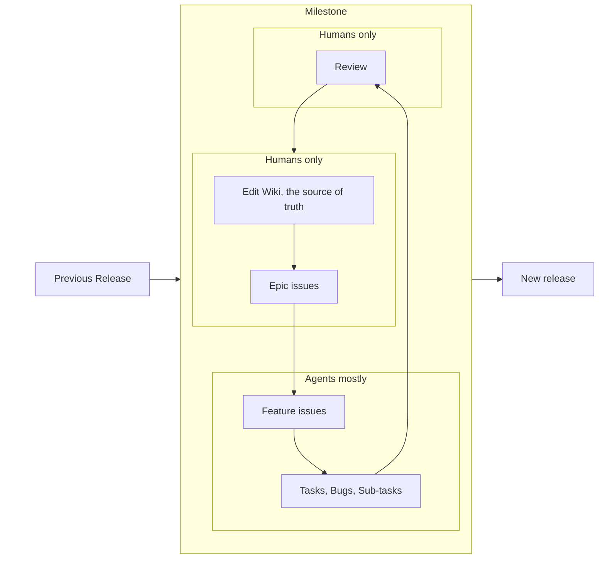
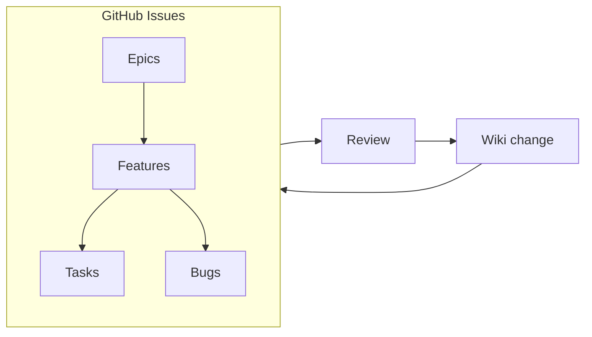

# Management workflow

> **Source of truth:** The [wiki Management page](https://github.com/ivanov-gv/cg-map/wiki/Management) is the
> authoritative source for this workflow. This repository copy exists so agents working in the repository follow the
> workflow. When the two disagree, the wiki wins.

This is a project for testing and polishing AI-first development strategies. The workflow is:

1. Edit the Wiki, add everything you want to change in the project
2. Define Epic tasks and add them to a new Milestone
3. Ask your AI Agents to help with defining Features for each Epic
4. Run your Agents to implement everything you have added
5. Review, see the result in a staging environment, add more GitHub Issues if needed
6. When everything is done, make a Release, close the Milestone

## Wiki

The single source of truth about the project. The place where every idea is written.

It should contain:

- Home - "what is it about?"
- Getting started - onboarding
- Docs — every document about the project as a whole
  - Management
  - Development
- Per-project docs
  - Web app
  - Editor
  - Core
  - Data
  - Platform

## GitHub Issues

Every issue must have:

- Type
- A label with the project it is attached to
- Proper hierarchy

See also
[ADR 0009 — Issues are the source of truth for tasks](../decisions/0009-issues-are-the-source-of-truth-for-tasks.md) and
[plan rules](../plans/AGENTS.md) for how issues connect to PRs and plans. The wiki holds what the project should be; an
issue holds a task's scope and status.

### Epics

- No attached pull requests
- Never have a parent
- Only have Features as children
- Imported into the Overview project

### Features

- May have a separate git branch for development
- Always have a parent issue of type Epic
- May have only Tasks or Bugs as children
- If the parent Epic has a git branch, the Feature must have a pull request to that branch

### Tasks or Bugs

- May only have a Feature as a parent issue
- May only have sub-tasks as child issues

## Agents and the wiki

The wiki is human-written. Agents may read it freely via the web page, the raw file
(`https://raw.githubusercontent.com/wiki/ivanov-gv/cg-map/<Page>.md`), or a clone of
<https://github.com/ivanov-gv/cg-map.wiki.git>. They must never edit or push to it. If an agent needs to propose a
change, it should add a comment on the relevant issue so a human can apply it. The wiki footer states this rule, but it
is not visible when reading a raw file or a cloned repository, which is why this section repeats it here.
